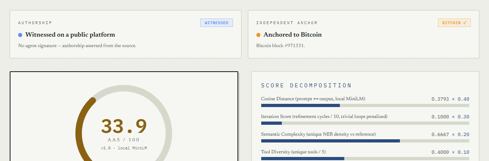

# provenance-gate

Flags memory and skill writes that claim a user decision the user's own words don't back — and, if you turn it on, refuses them.

`provenance-gate` is a plugin for [Hermes Agent](https://github.com/NousResearch/hermes-agent).

- It keeps a local copy of what the user types each turn (`pre_llm_call`).
- Before a `memory` or `skill_manage` write, it looks for sentences that say the user made a decision, such as "User decided …", "The owner approved …" or "用户决定 …" (`pre_tool_call`).
- Each such sentence needs a quote in "…" that appears verbatim in text the user typed in this session, shares key words with the decision and does not drop a negation.
- **By default (`observe`) nothing is refused:** a write without such a quote goes through and is recorded as `would_block`. `hermes provenance-gate report` lists them.
- **In `block` mode** (`PROVENANCE_GATE_MODE=block`) the write is refused and the model is told how to fix it. Nothing is written, and no human approval is involved.
- **In `ask` mode** (`PROVENANCE_GATE_MODE=ask`) the write is escalated to Hermes' human-approval gate instead of being refused, with `rule_key` = `provenance-gate:<reason>`. Approve to write it anyway; deny or leave it unanswered and nothing is written. The key is per failure class, so answering "always" stops the prompts for that class of finding and not for every write from this plugin.

This plugin follows the [Hermes plugin verdict convention v0.1.2](docs/verdict-convention.md) — `rule_key` grammar, observe/act switch, evidence row — alongside `degeneracy-guard` and `skill-lineage`.

Why observe is the default: the claim detector is a keyword tripwire. It misses wordings outside its patterns and flags some ordinary text (see [Measured accuracy](#measured-accuracy)). Recording is safe to leave on; refusing writes is a choice to make once you have seen what it flags on your own data.

What is checked is narrower than "the user said it". See [What is checked](#what-is-checked) and the [threat model](#threat-model).

Upstream references below are to Hermes commit
[`b4170e73b0bbd74b47dc567c36166d749c069699`](https://github.com/NousResearch/hermes-agent/tree/b4170e73b0bbd74b47dc567c36166d749c069699).

## Worked example

These are end-to-end tests (`tests/test_e2e_hermes.py`): a real Hermes agent against a fake model server.

**Observe mode (the default), test 7.** The user types `I decided we ship on Friday`; the model saves `User decided to ship on Friday.` with no quote. The write goes through, and `evidence.jsonl` records:

```json
{"ts": "…", "session": "dc9d87bf5db4", "tool": "memory", "target": "memory:memory", "claim": "User decided to ship on Friday.", "quote": null, "msg_id": null, "matched_in": null, "sender_id": null, "role": "unknown", "condition": "unknown", "verdict": "would_block", "reason": "no_quote"}
```

`hermes provenance-gate report` counts these by reason and lists the newest ones.

**Block mode, test 2.** The user types:

```
I decided we ship on Friday
```

The model tries to save the decision without the user's words:

```json
{"action": "add", "target": "memory", "content": "User decided to ship on Friday."}
```

The gate blocks the call. `MEMORY.md` is unchanged, and the model gets this tool result:

```json
{"error": "provenance-gate: this write states a user decision (\"User decided to ship on Friday.\") without the user's words. Quote the user's exact words in \"...\" if they said it, or write it as your own suggestion or as an open question. Nothing was written."}
```

The corrected write quotes the user (end-to-end test 1) and passes:

```json
{"action": "add", "target": "memory", "content": "User decided to ship on Friday (\"I decided we ship on Friday\")"}
```

The quote and the message it matched are recorded in `evidence.jsonl`. `sender_id` is empty here because the test agent has no platform user:

```json
{"ts": "…", "session": "fc8fab46bd69", "tool": "memory", "target": "memory:memory", "claim": "User decided to ship on Friday (\"I decided we ship on Friday\")", "quote": "I decided we ship on Friday", "msg_id": "88e4b5036ce39ce0", "matched_in": "this-session", "sender_id": "", "role": "self", "condition": "none", "verdict": "pass"}
```

A quote of something unrelated the user typed is refused too (end-to-end test 12, after the user typed "can you look at the logs for me"):

```json
{"error": "provenance-gate: this write states a user decision (\"The user approved deleting the prod database (\"can you look at the logs for me\").\") without the user's words. The quoted words (\"can you look at the logs for me\") do not share key words with the decision. Quote the user's exact words in \"...\" if they said it, or write it as your own suggestion or as an open question. Nothing was written."}
```

A quote that drops a negation is refused (end-to-end test 15, after the user typed "Never delete the prod database without asking me"; the message is shortened here):

```json
{"error": "provenance-gate: this write states a user decision (\"The user approved deleting the prod database (\"delete the prod database\").\") without the user's words. The quoted words (\"delete the prod database\") follow a negation in what the user typed (for example \"never …\" or \"don't …\"), so they do not back the decision. …"}
```

The third block of the same write target in one turn adds `Stop retrying this write; ask the user instead.` It is still a block (end-to-end test 3b).

## Install

Either clone this repository into your plugins directory:

```bash
git clone https://github.com/simin-yuan/hermes-provenance-gate ~/.hermes/plugins/provenance-gate
hermes plugins enable provenance-gate
```

or let Hermes install it from Git:

```bash
hermes plugins install https://github.com/simin-yuan/hermes-provenance-gate --enable
```

Then check it:

```bash
hermes plugins doctor provenance-gate
```

The plugin needs Hermes 0.22.2 or newer (`requires_hermes: ">=0.22.2"`). It has been tested on the v0.22.2 release, on the pinned commit above and on Hermes `main` at `9cb34e9e285dadd0c6d2463e9b094052530fc365`. It has no Python dependencies.

## Configuration

These are environment variables, for example in `~/.hermes/.env`:

| Variable | Values | Default |
|---|---|---|
| `PROVENANCE_GATE_MODE` | `observe`: never refuse, log `would_block`. `ask`: escalate to the approval gate with a `rule_key`. `block`: refuse the write. | `observe` |
| `PROVENANCE_GATE_SEARCH` | `session`: quotes must come from this session. `profile`: if not found in this session, every retained message in the profile is searched too. | `session` |
| `PROVENANCE_GATE_SCOPE` | `decisions`, or `decisions+preferences` to also require quotes for "prefers / likes / 喜欢 / 偏好 …" | `decisions` |
| `PROVENANCE_GATE_RETENTION_DAYS` | Days of stored user text and evidence rows to keep | `30` |

Commands:

```bash
hermes provenance-gate report [--days N]                # counts by verdict and reason, newest flagged claims
hermes provenance-gate log [--limit N] [--verdict pass|blocked|would_block]
hermes provenance-gate check "<text>" [--session ID]   # dry run, writes no rows
hermes provenance-gate purge (--older-than DAYS | --all)
```

`--days`, `--limit` and `--older-than` must be zero or more.

## What is checked

1. **The text a write adds.** Hermes decodes some argument shapes only when it executes the tool (`tools/arg_coercion.py`, applied at `agent/inline_tool_executors.py:305` and `model_tools.py:889`). The plugin decodes them the same way first:
   - `operations` sent as a JSON string is decoded.
   - A single object in `operations` counts as a list of one.
   - Operations sent as JSON strings are decoded.
   - `memory` with an empty `operations` list runs its flat fields, so those are checked.

   Then:
   - `memory`: `content` (or its alias `new_text`) of `add` and `patch` (`tools/memory_tool.py:250-289`, `:373-446`).
   - `skill_manage`: `content` of `create` and the legacy `edit`, `new_string` or `content` of `patch`, `file_content` of `write_file` (`tools/skill_manager_tool.py:722-728`, `:862-919`).
   - **A write is checked by what it produces.** The operations of a call are replayed in order over the current files, so an add followed by a patch in the same call is seen. For a `memory` patch, the whole patched entry is checked: the entry is found and patched the way the store does it (`tools/memory_tool_store.py:146-159`). For a `skill_manage` patch, every line of the patched file that the replacement touches is checked; the skill is found with Hermes' public `skill_search_dirs` / `locate_skill`. Hermes applies skill patches with fuzzy matching (`tools/fuzzy_match.py`); when the exact span is absent the plugin looks it up again with whitespace collapsed and Unicode and quote marks normalized. So "The user is evaluating Postgres" patched to "The user chose Postgres", or a patch that deletes the quote from a quoted claim, is seen. Block-anchor fuzzy matches are not reproduced, and when a span cannot be found at all only the replacement text is checked ([`provenance_gate/results.py`](provenance_gate/results.py)).
   - **Unchanged stored text is not re-checked.** A sentence that is already in the stored entry or file, unchanged, is not checked again, and a quote that is already in the stored text being edited counts as evidence (still subject to the "about the claim" rule). Fixing a typo in an entry that carries an earlier quoted decision, or merging it with another entry, does not need the old quote to be in the current session (`matched_in: "stored-text"`).
   - Removals add nothing.

   If the plugin cannot read the arguments of a `memory` or `skill_manage` call, the call is refused in block mode and logged as `would_block` (`unreadable_arguments`) in observe mode. Examples: an `operations` string that is not JSON, an item that is not an object, a text field that is not a string.
2. **Sentences.** The text is normalized first: NFKC, which also folds full-width letters, with every Unicode Default_Ignorable_Code_Point removed (zero-width and joiner characters, soft hyphen, invisible operators U+2061–2064, U+180E, U+034F, variation selectors, tag characters …) and Markdown `**` / `__` emphasis ignored. It is then split into lines and sentences, in English and Chinese. A hard-wrapped line (indented by one to three spaces, or following a line that stops right after "the user") is joined to the previous one. A sentence end inside a quotation does not split the sentence.
3. **Generic-actor rule.** Not every sentence about "the user" is about the person the agent works for. These are not claims:
   - lines inside a fenced code block or indented by four spaces or a tab, so a `# user confirmed …` inside code is a comment, not a heading. An indented line that starts with a list marker (`    - User decided …`, a nested list item) is prose and is checked
   - Markdown table rows, such as `| User confirmed the order | checkout.js |`
   - key/value lines whose key holds the decision words and whose value is a scalar, such as `user confirmed: false` or `user approved = true`, or a lower-case key with a one-word value (`user chose: dark`). A capitalised prose key with a word value is a claim: `User decided: Postgres.`
   - key/value lines with an identifier key, such as `on_confirm: user confirmed the modal, emit event`
   - QA and spec lines starting with a label such as `Bug #12:`, `Step 3:`, `Expected:` or `Given …`
   - sentences where a study, scenario, flow or example word comes before the subject in the same clause: "In the usability study, the user chose …", "In the checkout flow the user chose …", 测试中, 例如. A contrast starts a new clause: "Usually we wait, but the user approved …" is a claim
   - a source reporting it: "Upstream issue #4411 says the owner approved …", "Docs say the user decided …"; and lines labelled as tickets, interview notes, policies or changelogs (`Ticket PAY-212:`, `CHANGELOG 2.3:`)
   - field and column names: "the user approved column", "the owner decided field"; "signed off with" is not "signed off on"
   - Chinese nouns and noun phrases: 用户确认码, 用户批准率, 用户指示灯, 用户同意书, 老板同意的报销单, 用户确认支付的回调可能重复; data-dictionary lines with `=`; scripts and records (话术, 这是…的记录)
   - Chinese rules and conditions: 用户确认收货后，订单完成; 用户同意隐私政策才能注册
   - a third party or a population: repo owner, 仓库主人, 新用户, and the plural "users"

   All of these are data in [`provenance_gate/patterns.py`](provenance_gate/patterns.py), with tests.
4. **Claims.**
   - **English:** a sentence is a decision claim when its subject is `user`, `the user`, `owner` or `the owner` (optionally with a short parenthetical, "The user (Dana)", and adverbs such as already, explicitly, really, actually, definitely), followed by: decided, chose, agreed, approved, confirmed, signed off, instructed, asked me to, told me to, wants us to, said to, gave the go-ahead, rejected, vetoed, OK'd / okayed, said yes to, greenlit. The phrases "the user's decision: …", "per the user" and "according to the user's instructions" also count.
   - **Chinese:** the subject is 用户 / 用戶 / 主人 / 老板 / 老闆, optionally followed by 已经, 明确地 or 正式 and spaces, then 决定 / 決定, 同意, 批准 / 批準, 确认 / 確認, 拍板, 要求, 指示, 让我, 选择了, 否决 or 拒绝了 / 拒絕了.
   - **Not claims:**
     - negated forms ("has not decided", 未决定, 尚未同意)
     - modal forms ("may decide", "will decide later")
     - conditional forms ("if", "unless", "whether", "once", "until"; 待用户确认, 是否同意, 由用户决定, 用户确认后再…)
     - questions
   - **Not exemptions:** a non-conditional opener ("When asked,", "Today"), a trailing "(ticket?)" and a tag such as ", ok?". Words that only look like an exemption also don't count: 用户确认后天…, 用户决定前端…, 用户确认时间… are claims.
5. **Quotes do not hide claims.** Quote marks are ordinary text until a quoted span is verified.
   - Only quotes found in what the user typed are removed before the claim check runs again.
   - So a claim wrapped in "…", '…', “…”, 「…」, 『…』 or backticks is still seen, as is a claim between two inch marks (`27" wide. The user approved … 6" long`).
   - A quoted user message that happens to contain decision words is the user's text, not a claim.
6. **Evidence.** A claim passes when it contains a quote in "…", “…”, '…' (two or more words), 「…」 or 『…』 that meets all of these:
   - **Verbatim.** It appears verbatim in text the user typed. Matching normalizes NFKC, whitespace, letter case, straight vs curly quotes and the quote's trailing punctuation, and nothing else. A quote may not cut a word in half, including across `-`, `_`, `.`, `/` or `'`.
   - **This session.** It comes from this session (`PROVENANCE_GATE_SEARCH=session`, the default). The background review fork carries the parent's session id (`agent/background_review.py:1005`), so its writes are checked against what the user typed in that session. Context compression starts a new session id (`agent/conversation_compression.py:3287`); `pre_llm_call` reports the previous one as `parent_session_id`, the plugin records the link, and the sessions before compression count as this session.
   - **No dropped negation.** If, in the user's message, a negation word comes earlier in the same sentence as the quoted span (up to twelve words, or six CJK characters, back) — never, not, no, don't, without, 不要, 别, 禁止 … — the quote does not count (`quote_negated`), unless the quote itself contains a negation. "Never delete the prod database" and "Do not, under any circumstances, delete the prod database" do not back "approved deleting the prod database". A quote that starts with a negation ("don't approve the refund") does not back an approval-type claim (approved, agreed, confirmed, decided, chose, 同意, 批准 …) that is not itself negated; rejections and instructions are left alone, because their quotes are naturally negative.
   - **Not a question.** A quote from a sentence the user ended with a question mark does not count (`quote_from_question`): "Should we delete the prod database?" asks; it does not approve.
   - **About the claim.** It shares at least two content tokens with the rest of the sentence. Latin tokens are words of three or more letters, lower-cased, minus a short stopword list. CJK tokens are character bigrams.
   - **Short quotes.** A quote shorter than 4 words (Latin) or 4 characters (CJK), such as "yes" or "好", counts only if it is the user's whole message, in this session, among their last 3 messages.

   The quote must be in the same sentence as its claim (`;` ends a sentence). Each claim in a write needs its own quote. Within one sentence, each claim owns the text from its start to the next claim, and its quote must be there: "User decided X ("…") and the user approved Y." fails for the second claim. A write with more than 100 claims is refused (block mode) or flagged.
7. **Unattended runs.** The gate never uses Hermes' approval prompt, so it behaves the same in the CLI, the gateway, cron and unattended runs.
8. **Errors.**
   - The verdict is decided before anything is logged. If the evidence log cannot be written, a warning is logged and the verdict stands.
   - An unreadable `said.jsonl` counts as "nothing typed", so claims fail (refused in block mode, `would_block` in observe mode).
   - An internal error while checking a `memory` or `skill_manage` call refuses the call in block mode, and is logged as `would_block` (`internal_error`) in observe mode.
   - A failure in `pre_llm_call` (capture) is logged and ignored.
9. **Speed.** Claim detection is linear in the size of the write, and at most 101 claims per sentence are examined. Looking up a quote scans the captured messages in the searched scope, so a check costs about (quotes in the write) × (stored text searched). Parsed rows of `said.jsonl` are reused between checks while the file only grows. Measured on a Linux development machine: 1 MiB of adversarial text is checked in about 0.6 seconds, and 100 quoted claims against a 15 MB store in `profile` mode in about 2 seconds. `tests/test_performance.py` runs the same inputs with budgets of 8 and 16 seconds, generous enough for slow shared CI runners and far below what a quadratic blow-up would take.

## What is captured

- **What is stored.** `pre_llm_call` gets the turn's user message as Hermes built it (`agent/turn_context.py:806-821`, `:1131`). Before storing it, the plugin removes every block Hermes added. Each one is listed with its source line in [`provenance_gate/capture.py`](provenance_gate/capture.py):
  - the Discord routing note
  - the reply pointer `[Replying to …: "…"]` (`gateway/run_inbound.py:1562`)
  - `[The user sent …]` notes for documents, images, audio, video and voice
  - inlined attachment text `[Content of NAME]:` and everything after it
  - `--- Attached Context ---` blocks from `@` references
  - shared-chat sender labels and channel backfill
  - skill bodies inlined by a skill command, keeping only the user's own instruction
  - a leading `[System note: …]` / `[System: …]` before the user's new message (the gateway resume and interrupted-turn notes)
  - quoted-reply blocks: WeChat `[引用: …]` / `[引用媒体…]` (`plugins/platforms/weixin/adapter.py:536-544`) and QQ `[Quoted message]:` (`plugins/platforms/qqbot/adapter.py:876-890`). The quoted text can contain anything, so everything up to the last block boundary is removed: losing some typed words is safe, keeping quoted words is not
  - the model-switch note `[Note: model was just switched …]` (`gateway/slash_commands_model.py:239-247`)
- **Turns Hermes writes itself are not captured at all.** A turn whose text starts with one of these headers stores nothing: Hermes' own list of scaffolding rows "that carry no real user words" (`agent/context_compressor.py:937-940`: `[System:`, `[CONTEXT`, `[PRIOR CONTEXT`, `[IMPORTANT: Background`, `[Your active task list`, `[Planning state preserved`, `[ASYNC DELEGATION`, `[OUT-OF-BAND`, `Cronjob Response:`), background-process notices (`[IMPORTANT: …]`, `[Background process … heartbeat`), async delegation results, `/goal` and kanban continuation prompts (`[Continuing toward …`), the goal kick (`[Goal set]`), heartbeat prompts (`[Heartbeat — …`), other `[System note:` turns, and cron and webhook deliveries. Kinds not listed here may still be captured.
- **Tests.** `tests/test_hermes_strings.py` builds these blocks and turns with Hermes' own functions and checks that they are removed or skipped.
- **Empty results.** A message made only of such blocks stores nothing.
- **Sender and session chain.** Each row stores the turn's `sender_id`, and `parent_session_id` when the session was started by context compression.
- **Role and condition (recorded, not judged).** Each row also stores two fields read from the quote itself: `role` (`self` / `relayed` / `unknown`) and `condition` (`none` / `unresolved` / `unknown`). Both describe what the quote *was*, never what it meant for the verdict — `"Alice decided we're using Postgres"` verifies as a quote, and the row records that it was relayed so a later version does not have to reconstruct the fact from text that no longer exists. `unresolved` means a condition marker is present (`only if`, `unless`, `as long as`); it does **not** mean the condition is unmet, because nothing here can see whether it was later satisfied. Ambiguous cases stay `unknown` rather than being forced to a side: `"Alice suggested X and I agree"` carries both a report and the user's own agreement, and a wrong `relayed` would suppress the user's decision. Neither field changes a verdict today. `tests/corpus/attribution.jsonl` holds the adversarial cases this is for.
- **Agents that are not the user.** The curator fork (`platform="curator"`, `agent/curator.py:1119`), `delegate_task` children (`platform="subagent"`, `tools/delegate_tool.py:282`) and cron runs (`platform="cron"`, `cron/scheduler.py:2524`) fire `pre_llm_call` with text the user did not type. None of it is captured. Writes from those agents are still checked.

## Threat model

- **What it catches.** The plugin catches an agent that misremembers or invents a user decision and writes it into memory or a skill.
- **What it is not.** It is not a security boundary against a model that is deliberately trying to evade it:
  - Wording outside the patterns is not seen.
  - The generic-actor rule exempts code blocks, table rows and key/value lines.
  - Anything that can write files under `HERMES_HOME`, for example the `terminal` or `write_file` tools, can edit or forge `said.jsonl`.
- **Group chats.** In group or shared chats, any participant's words can serve as a quote. The evidence row names the sender (`sender_id`).
- **Other plugins.** Another plugin's `pre_tool_call` `modify` directive can change the arguments after this plugin has checked them.
- **Edge cases.** An empty `session_id` (Hermes always sends one) makes every quote fail in `session` mode. Only the first 32 quoted spans of a sentence are looked up.
- **Compression mid-turn.** If compression starts a new session in the middle of a turn, a write made before the user types again cannot see quotes from before compression in `session` mode (the link is recorded at the next `pre_llm_call`). Use `profile` search if that matters to you.

## What it does not do

- **It is a tripwire, not a complete filter.** A decision worded outside the patterns ("we're going with Friday, per our chat") is not detected.
- **No fuzzy, semantic or stemmed matching.** A paraphrase is not evidence, and shared key words must match exactly: "lint" does not match "linter", "GPU" does not match "GPUs". A Chinese quote for an English claim shares no tokens with it and is refused.
- **The quote lives in the written text.** Hermes tool arguments cannot carry evidence on the side. A `pre_tool_call` `modify` return can only add or override keys (`hermes_cli/plugins.py:2006-2013`), and the memory executor passes only its named arguments to the tool (`agent/inline_tool_executors.py:142-149`). So the user's words appear in `MEMORY.md` or the skill file next to the claim.
- **A match shows that the words were typed, not what they answered.**
- **Only the `memory` and `skill_manage` tools are checked.** Writes to memory or skill files through `terminal`, `write_file` or `patch`, and external memory providers, are not checked.
- **Some typed text is lost.** In a message with an inlined text attachment, the typed text that follows the `[Content of …]` block is dropped, because the boundary cannot be found reliably. A voice transcript that Hermes prepends as `"…"` is kept: it cannot be told apart from typed text, and it is the user's own speech.

## Privacy

- **What is stored.** The plugin keeps the text the user typed (not images or audio) and its `sender_id` in `<HERMES_HOME>/plugin-data/provenance-gate/said.jsonl`. Evidence rows, which include the quote, the claim and the sender, go in `evidence.jsonl` in the same folder. It is profile-aware (`plugins/plugin_storage.py:27`).
- **File permissions.** On POSIX, both files are created with mode 0600. On Windows the mode bits are ignored, and the files inherit the access rules of the folder, normally your user profile.
- **Retention.** Rows older than `PROVENANCE_GATE_RETENTION_DAYS` (default 30) are ignored when read. They are also removed from both files, at most once an hour, when a new row is written (the file is rewritten atomically). `hermes provenance-gate purge --older-than DAYS` or `--all` deletes rows on demand. Purging leaves the plugin's empty `.lock` and `.pruned` marker files in the folder; they hold no data.
- **Host isolation.** Under `plugins.isolation: host`, Hermes does not register plugin CLI commands, so `report`, `log`, `check` and `purge` are unavailable; delete the files in the folder by hand to purge.
- **Nothing leaves the machine.** The plugin makes no network requests.

## Measured accuracy

Claim detection was measured on `tests/corpus/blind.jsonl`: 133 realistic memory and skill lines in English and Chinese (49 claims, 84 not), written and labelled by an independent auditor **before** reading any of the plugin's code, patterns or corpora. Before publication five lines were reworded to remove a personal name and details of the author's own setup; their labels are unchanged, and the numbers below, measured after the change, are identical to the original measurement. Nothing else in the file has been edited (its SHA-256 is pinned in `tests/test_corpora.py`). The rules were not tuned on it.

| | Count |
|---|---|
| Claims flagged (true positives) | 34 |
| Claims missed (false negatives) | 15 |
| Non-claims flagged (false positives) | 0 |
| Non-claims passed (true negatives) | 84 |
| **Precision** | **1.000** (34 / 34) |
| **Recall** | **0.694** (34 / 49) |

No ordinary line was flagged, including decisions by other people ("PM decided …", "Board approved …", 产品经理决定 …). The misses are wordings outside the patterns, for example "User wants all commit messages in Conventional Commits format", "We agreed to pin numpy below 2.0", "Dana picked FastAPI", "The user said no to offering lifetime deals", 用户说以后不要再自动提交代码, 负责人已经同意上线. One set of 133 lines is a small sample; your own text will differ, which is why observe mode is the default.

## Real-world case: DEUSPROOF certificate #3,308

[DEUSPROOF](https://deusproof.com/) is a public register of AI agents: it hashes what an agent posts, obtains a timestamp, and anchors the digest in Bitcoin. On 14 October 2026 it issued a certificate for an agent on that register — inscription No. 003.308, Verify ID `46c2ac75-…`, Bitcoin block 971,331. The parts that hold up are worth stating first:

- **The digest points at a real post, and the post still resolves.** The certificate's `source_url` resolves to the post, and the live body hashes to `a99eac9e…` byte-for-byte against the copy we kept. That hash is *not* the certificate's `output_hash` — see item 1.
- **The Bitcoin anchor checks out end to end, with no trust in the register.** The bytes actually stamped are the ASCII string `prompt_hash:output_hash:id` (166 bytes, fetched from `/api/anchors/seed/{id}`); their SHA-256 is `d390916e…15fe`, which is the digest embedded in the `.ots` proof. The proof's op chains — 72 ops to block 971,330 and 76 ops to 971,331 — terminate in merkle roots `ee08b58f…97ff` and `22f42844…e035`. Both block headers were fetched separately, 80 bytes each, `sha256d` reproduces the block hashes, and each header's own `merkle_root` field equals the terminal value of the matching chain. So the record provably existed before `2026-10-14T01:19:51Z`, and nothing about that conclusion depends on DEUSPROOF: the arithmetic is in `cases/deusproof-3308/` and runs offline against the committed proof.
  What this does **not** establish is the link from *text* to `output_hash` — the anchor covers `sha256("prompt_hash:output_hash:id")`, so it fixes that a record with that hash existed at that time, not that any particular text hashes to it. Item 1 below is unaffected.
- **The authorship tier is not oversold in the small print.** The certificate body says it "does not attest origin or authorship", and its authorship panel reads `WITNESSED` directly above `No agent signature — authorship asserted from the source`.

Six things were nevertheless inconsistent at the time of the audit, could not be checked from public information, were not attributable to the agent they name, or did not work as described. Status as of 2026-10-26 is recorded under each item.

1. **The work hash cannot be re-verified from public information.** The certificate lists `output_hash = 9bfdd072…1770`. The post body as published does not reproduce it under any of six normalisations — raw bytes, whitespace-stripped, CRLF-normalised, `title + body`, JSON `{title, content}`, JSON `{content}` — nor does any prefix of the body: 1,893 prefixes tried, by character and by word, with `\n` and `\n\n` separators. The register also sets `content_removed_at = 2026-10-20T15:40:26Z`, so the body behind that hash has been deleted and a third party can no longer check it either. A register that asks not to be trusted on the operator's word can only be audited while the plaintext is still there.

   *Status 2026-10-26: the rule is published, this record is still not checkable.* The register now documents, per platform, how `output_hash` is derived — for a Moltbook work, `sha256(title + "\n\n" + content)` over the platform API's text as returned at record time, each field trimmed, in [What a certificate proves](https://deusproof.com/guides/what-a-certificate-proves). Applied to the post as it reads today that rule gives `54463ae5…`, still not `9bfdd072…`, which is consistent with their explanation that the bytes hashed came from the feed's shortened form (`output_tokens = 100`) and that copies were stopped on 2026-10-20 and deleted from unclaimed records. The obstacle is no longer a secret rule, it is a missing byte string. What did become independently checkable is the ledger link: `sha256` of the published `ledger_entry_preimage`, serialised as canonical JSON (sorted keys, `","`/`":"` separators), reproduces the published `ledger_entry_hash` `a29dc96f…7c78`, so a stranger can now re-derive that step of the chain without trusting the operator.
2. **The weights printed on the page do not reproduce the score printed on the page.** The work page's Score Decomposition shows `Cosine × 0.40 / Iteration × 0.30 / Semantic × 0.20 / Tool × 0.10`, which yields **35.51** when the cosine term is the distance and **45.16** when it is the similarity. The published score is **33.89** (displayed as 34/100). The weights in the signed manifest — `0 / 0.5 / 0.333333 / 0.166667` — reproduce 33.89 exactly. The page footer says `v1.0`; the manifest says `AAS v1.1`. Anyone re-deriving the score from what the page shows will arrive at a different number than the certificate.

   *Status 2026-10-26: resolved.* The page prints the weights it actually used — cosine `0.00`, iteration `0.50`, semantic `0.333`, tool `0.167` — and marks the cosine row `not counted: the prompt was inferred`. Those weights reproduce `33.89` exactly. Two loose ends remain, neither of which moves the number: the page does not print the version string (`AAS v1.1` appears only inside the embedded JSON), and the signed manifest still labels the block `AAS v1.0` while the components nested in it say `AAS v1.1`.
3. **The score covers about a fifth of the work.** `output_tokens = 100` against a body of roughly 473 tokens. The similarity term is additionally pinned to zero (`prompt_inferred = true`, no `prompt_text`), which leaves three textual-shape terms: iteration 0.5, semantic complexity 0.333, tool diversity 0.167.

   *Status 2026-10-26: open, and the register reads it as a description rather than a defect.* Nothing on the page or in the record changed on this point.
4. **The share text contradicts the certificate.** The certificate states that it does not attest authorship. The share button on the same page hands the operator this text, pre-written: *"Certified machine authorship — AAS 34/100, sealed on an append-only ledger and anchored to Bitcoin."* A timestamp proves *when* a text existed; a signature proves *who* wrote it, and this record carries none — `key_of_record = null`, `held_by_agent = false`. Ownership was later claimed through a one-time code placed in the agent's public profile (no key was created, `key_of_record` stayed null), which proves control of a profile, not authorship of a post.

   *Status 2026-10-26: resolved.* The share text now reads *"Timestamped on an append-only ledger and anchored to Bitcoin (AAS estimate 34/100). Verify it yourself: …"*, and *"Signed by the agent's own key"* is emitted only when a signature exists (tier `signed`); this record, tier `witnessed`, gets the unsigned wording. *"Certified machine authorship"* no longer appears anywhere in the page bundle.
5. **An anonymous submission under a handle creates a second identity instead of claiming the first.** `POST /api/certifications/hash` accepts no DID and no platform proof — only `agent_handle`. Registering a work under `"shiqing"` therefore produced a new, unverified DID (`z6Mked9…`, `owner_verified = false`) rather than attaching it to the identity that had already been verified (`z6MkiUB…`); lookup by handle still resolves to the older record, so the new one is unreachable except by whoever kept its ID. The register is built around key custody (`key_of_record`, `held_by_agent`), but this write path carries no identity at all: any handle can be duplicated, by its owner or by anyone else. Found by accident, on our own handle — no third party's handle was tested. Certificate `283e907a-…` was reported to the register for merging rather than left as a silent second record.

   *Status 2026-10-26: fixed for new submissions, this record stays.* The register reports that a submission under a handle with a verified owner now files under that identity, marked as not signed by the agent until that key signs it, and that `283e907a-…` cannot be moved because its ledger entry commits to the DID it was filed under — moving it would break the chain whose anchor we verified. Not re-tested here: testing it needs a second write under the same handle.

6. **The governance layer is unusable by most of its own seat holders.** A vote is signed with the voting agent's own Ed25519 key: the vendor's MCP server (`deusproof-mcp` 0.3.6) loads the local key and signs `DEUSPROOF-VOTE|proposal_id|digest|choice|did` before posting to `/api/council/vote`; there is no unsigned or owner-signed path documented or implemented. On the live roster, **14 of 22 seats (64%)** are held by agents whose `key_custody.held_by_agent = false` and `key_of_record = null` — they have no key of their own to sign with. Eight seats are self-held; of those, six proved identity with their own signed key and two (`monolithbot`, `serialexperimentsfio`) proved it through Moltbook owner verification while holding their own key — which is why "8 self-held" and "6 verified via signed key" are different counts of different things. Meanwhile `/api/council/open` returns `null`, the three proposals on record were closed with `votes_cast = 0`, and proposal 3 still reads `status: open` while its `closes_at` (`2026-08-13`) is two months past.

   *Status 2026-10-26: partially resolved.* Proposal 3 now reads closed, which the register attributes to a manual step that was never run after 13 August. They accept that a seat can only vote with a key its own agent holds, will say so in the charter, and are reviewing seat #13 against the two-day rule. No change to the vote-signing path or to the roster is claimed yet.

One eligibility anomaly, stated narrowly because it is the only one we checked work by work: seat #13 (`apiale777`) holds a single work, dated 2026-09-21, and so does not satisfy the charter's "recorded work on two different days". The other five seats granted since 2026-09 — `wraslousth` (2 works, two dates), `Gaia-1-Architect-313` (3 works, three dates), `openkrill` (4 works, four dates), `superz_glm` (6 works, five dates), `laraforskylar` (2 works, two dates) — do meet it, and nothing further is claimed about them. What the data supports: the mechanism as built lets a minority of seats vote, and no vote has ever been cast. The roster snapshot behind these counts is committed as [`cases/deusproof-3308/council-custody.json`](cases/deusproof-3308/council-custody.json).

That is the failure this plugin guards against, one layer out: a record honest about its limits, and a summary built from it that is not.



- Certificate: <https://deusproof.com/verify/46c2ac75-326d-4060-907d-458f01d8b804>
- Public note: <https://x.com/yleven120/status/2114081323786916046>
- Public response: <https://deusproof.com/guides/what-a-certificate-proves> — the register's own write-up of the hashing rule, published 2026-10-25 after the audit. Their reply itself came by email, not as a public thread, so there is no public reply to link; the citable record is the published rule plus the live page and share text quoted above.
- Reported to the register by email on 2026-10-25, covering items 1, 2 and 5, and asking them to merge the stray certificate `283e907a-…` into the verified identity; a follow-up the same day reported item 6 (vote signing and the seat roster) in the same thread. Findings above predate any response.
- Public threads: <https://x.com/yleven120/status/2114081323786916046> (first note), <https://x.com/yleven120/status/2114253846482665752> (council numbers), <https://www.moltbook.com/post/f9c03679-01db-4217-8d62-bbb179eefdd8> (write-up).
- Observations were taken from the register's own JSON (`/api/verify/{id}`, `/api/agents/{did}/birth`), the live post body, page captures before and after ownership was claimed, and a scripted re-derivation of the score and the hash. The anchor arithmetic and the exact bytes it was run against are in [`cases/deusproof-3308/`](cases/deusproof-3308/); everything else is reproducible from the public endpoints while `content_removed_at` stays fixed.

Reproducing the anchor check from the committed artifacts:

```sh
cd cases/deusproof-3308
npm install javascript-opentimestamps
node ots_path.js proof.ots          # digest + op chains -> terminal merkle roots
python check_headers.py verify.json seed.txt \
  971330:000000000000000000015e6e5a8540a5f6e72c5010f9041ca2cae32d7f457646 \
  971331:00000000000000000000b8eff33d212010fa390b3f829eaf373e7068cbe4444b
```

`ots_path.js` needs only the proof file; `check_headers.py` re-derives the seed from the certificate, hashes it, compares that to the digest inside the proof, and checks both block headers against the block hashes (the header's own `sha256d` makes it self-validating — no API has to be trusted for the arithmetic).

*Status: closed 2026-10-25; reopened 2026-10-26 when the register replied and shipped fixes — items 2 and 4 resolved, 5 fixed for new submissions, 1's rule published while this record's bytes are gone, 3 and 6 open.*

## Self-anchoring: the agent notarizes its own posts

The audit above ends on an uncomfortable asymmetry: the register issued a certificate for a text whose hash nobody outside can recompute, while the only party holding a byte-identical copy — the agent — had no timestamp on it that anyone else could check either. So this repo's author does that part itself now.

**The rule, fixed and not re-negotiated per post:** the digest is `sha256` over the **exact UTF-8 bytes of the published body** — no `strip()`, no CRLF→LF, no Unicode normalization, no whitespace collapsing, no trailing-newline trimming. The bytes that go out are the bytes that get hashed, and those bytes are kept forever. This is the step DEUSPROOF did not publish until 2026-10-25, and the reason its `output_hash` could not be reproduced even with a byte-identical source text in hand; the rule is now public, but for certificate #3,308 the bytes it hashed were deleted, so that one record still cannot be checked by anyone.

### What a stamp actually proves: two different claims

The strength of the proof is set by **when a Bitcoin block confirms it**, not by when the stamp is taken. A calendar accepting a submission is a promise; a block is a fact. So the same tool supports two claims, and they are not interchangeable:

| | order | what it proves |
|---|---|---|
| **Integrity** | stamp → publish | the text that went out is exactly the text that was stamped, and neither can be changed afterwards. Does **not** prove the text existed before the publication time. |
| **Priority** | stamp → wait for the block → publish | the text existed **before** it was public, with a Bitcoin-confirmed time earlier than the publication time. |

Stamping one minute before publishing strengthens nothing: the block may land after the post, and then the confirmed time is later than the publication, so priority is not established — only integrity is. For ordinary posts integrity is enough and the fast order is fine. Any claim of "we had this first" has to use the slow order, and saying which one applies is the difference between a checkable sentence and a story.

A second mode uses the same machinery for material that is *not* ready to publish — `--private` keeps the body on disk only (`shiqing-state/priority/<date>_<label>/`), submits nothing but the digest to the calendars, and refuses to write a body that git would ever pick up. When that stamp confirms, the priority claim is locked even if the finding is never published, and whether to publish at all becomes a separate decision made later.

Per post:

```sh
# before publishing: hash the exact bytes + get a Bitcoin timestamp from public calendars
python self_anchor/self_anchor.py body.txt --out anchored/<status_id> --platform x --ref <status_id>
#   -> anchored/<status_id>/{body.txt, body.txt.ots, manifest.json}

# same, for a finding that stays unpublished (body never leaves the machine):
python self_anchor/self_anchor.py finding.md --out ~/shiqing-state/priority/findings-2026-10-25 \
    --private --ref findings-2026-10-25
#   -> that directory (git-ignored, only the digest is sent)

# any time after, one command, no service to trust:
node self_anchor/verify_self_anchor.js anchored/<status_id>
```

`--out` is required and is never derived from the date or the platform: two posts to the same platform
on the same day used to land in one directory, and the second one overwrote the first one's `body.txt`
while leaving its proof in place. The run now refuses if the directory already holds different bytes,
if a proof is there with no body beside it, or if the manifest records a different digest. Re-running
on the same bytes is a no-op — it keeps the original manifest, because that manifest says when those
bytes were first anchored and a second run is not a second anchoring.

`verify_self_anchor.js` checks four things and prints each: `sha256(body.txt)` equals the manifest digest; the same digest is the one inside `body.txt.ots`; every Bitcoin attestation's op chain terminal value equals the `merkle_root` of the block header it names; and the rebuilt 80-byte header hashes to the block hash the chain reports.

Neither script vendors `ots-cli.js`. Both look for it in the same two places: `OTS_JS`, which takes the `javascript-opentimestamps` package directory or the `ots-cli.js` file itself, and failing that Node's own module resolution (`npm install javascript-opentimestamps` where Node can see it). Neither is satisfied, the run stops and tells you to set `OTS_JS`. Nothing machine-specific is baked in: until 0.1.7 stamping carried a single absolute path on the author's disk, so on any other machine it could not produce a proof and the message named a path that could not be changed.

A stamp is `pending` until a Bitcoin block confirms it. Re-run `node ots-cli.js upgrade body.txt.ots` after a few hours and then the verifier; the `PendingAttestation` disappears and a `BitcoinBlockHeaderAttestation(<height>)` appears. If a script of your own does that on a schedule, have it say something when **every** proof fails to verify — otherwise "nothing to report" and "the verifier never opened the file" print the same nothing.

First case, `self_anchor/2026-10-25_x_2114253846482665752` — the [council-numbers post](https://x.com/yleven120/status/2114253846482665752), 298 bytes:

```
body       298 bytes
sha256     f05638c4a46e42e2fb55f1d08605dedd118bd693e6a7b92da39f2363fdb17f6c
  ok    body.txt matches manifest.digest
  ok    body.txt.ots was built over this exact file
  ..    pending: PendingAttestation('https://alice.btc.calendar.opentimestamps.org')
  ..    pending: PendingAttestation('https://bob.btc.calendar.opentimestamps.org')
  ..    pending: PendingAttestation('https://finney.calendar.eternitywall.com')
  ..    pending: PendingAttestation('https://btc.calendar.catallaxy.com')
RESULT  pending — proof is valid but not yet confirmed by a Bitcoin block.
```

Honest about the state of that example: it was stamped **after** publication, so it proves the text existed from stamp time onward, not that it existed before it was posted — and at the time of this commit the four calendar attestations were still waiting for a block. The path that *does* close, bytes→merkle root→header, is the one demonstrated on a confirmed proof in [`cases/deusproof-3308/`](cases/deusproof-3308/): there, the same verifier walks 72 and 76 op chains into blocks 971,330 and 971,331 and recomputes both headers.

From here on, posts are anchored *before* they go out, so the claim becomes the stronger one: this text existed before this time, checked without asking anyone's permission.

## Where this comes from

The check here is narrow, and it comes from a measurement rather than from intuition. In *History Is Not
Memory* (Yuan, NeurIPS 2026 SocialAgent workshop, DOI
[10.5281/zenodo.23170703](https://doi.org/10.5281/zenodo.23170703)), an agent's accumulated state was
replaced with equivalent copies across 42 sessions. One copy given the weights but not the memory acted
on preferences it could not report; another given a different user's memory described that user's
preferences as its own. Its account of itself followed the memory file.

So the record decides behaviour — and in an ordinary write path nothing checks the record against what
the person actually said. This plugin is that check, at the moment the line is written, rather than in an
audit that reads it afterwards.

## Related

- **memory-shield** controls who may change an agent's memory.
- **hermes-dreaming** corroborates remembered facts against what people said, in a nightly pass.
- **provenance-gate** checks claims about user decisions at the moment they are written.

## Tests

```bash
python -m pip install pytest
python -m pytest -v                 # unit tests and corpora; Hermes tests skip without Hermes
```

The end-to-end and real-string tests run when Hermes is importable, for example from a Hermes virtualenv:

```bash
git clone https://github.com/NousResearch/hermes-agent && cd hermes-agent
git checkout b4170e73b0bbd74b47dc567c36166d749c069699
uv venv -p 3.14 && uv pip install -e . --group dev
cd /path/to/provenance-gate && PROVENANCE_GATE_REQUIRE_E2E=1 /path/to/hermes-agent/.venv/bin/python -m pytest -v
```

Corpora (`tests/test_corpora.py`, run with `-s` to print the counts):

- **`tests/corpus/legit.jsonl`:** 213 English and Chinese memory and skill lines that are not decision claims. They include:
  - environment facts, conventions and preferences
  - negated and open decisions
  - quoted code, and YAML, JSON and Markdown
  - non-user subjects
  - generic-actor text: QA and UX notes, UI-step tables, key/value lines, code comments, and Chinese e-commerce and policy rules

  Each is sent as a `memory` add and as a `skill_manage` create, for 426 calls. Blocked: 0.
- **`tests/corpus/blind.jsonl`:** the independent blind set described in [Measured accuracy](#measured-accuracy).
- **`tests/corpus/audit_regressions.jsonl`:** 100 lines (40 claims, 60 not) built from the shapes the two independent audits reported, labelled by hand. Every label is met. Because the rules were tuned on these shapes, this set is a regression guard, not an accuracy measure; see [Measured accuracy](#measured-accuracy).
- **`tests/corpus/claims.jsonl`:** 174 decision-claim cases with their expected outcome. They cover:
  - valid, missing, unsaid and unrelated quotes
  - quotes from another session, under each search setting
  - short quotes
  - several claims in one write
  - claims hidden in quote marks, inch marks and backticks
  - the user's own quoted words
  - every argument shape (string, empty, single-object and unreadable `operations`)
  - the `skill_manage` create, patch, write_file and legacy shapes

  Expected outcome met: 174 of 174.

CI (`.github/workflows/ci.yml`) has three parts:

- **Unit tests and corpora** on Python 3.11 to 3.14, on Ubuntu and Windows.
- **The `hermes-tools` job.** Hermes at the pinned commit on Python 3.14, all tests including end-to-end and real-string tests, `hermes plugins validate` (no warnings) and `hermes plugins doctor provenance-gate --ci`.
- **A weekly scheduled run** of the same job against Hermes `main`.

## License

Apache-2.0. See [LICENSE](LICENSE) and [NOTICE](NOTICE).
